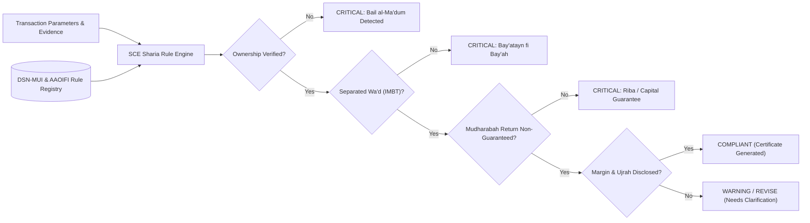
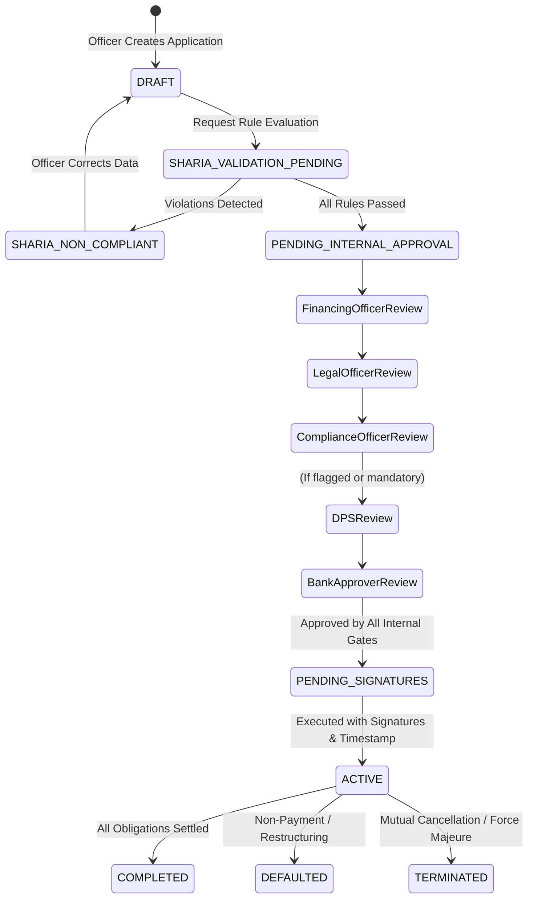

# SHARIA CONTRACT ENGINE (SCE) — SYSTEM ARCHITECTURE BLUEPRINT

> **Version:** 2.4.0-ENTERPRISE  
> **Status:** Production-Ready MVP  
> **Target Institutions:** Bank Umum Syariah (BUS), Unit Usaha Syariah (UUS), BPRS, KSPPS, BMT, Islamic Fintech  
> **Compliance Standards:** DSN-MUI Fatwas, OJK Regulations, Bank Indonesia Standards, AAOIFI Governance & Sharia Standards

---

## 1. Executive Architectural Overview

The **Sharia Contract Engine (SCE)** is an enterprise multi-tenant Software-as-a-Service (SaaS) platform built specifically to eliminate Sharia non-compliance risks (*Sharia non-compliance risk*), manual drafting friction, and audit deficiencies in Islamic financial transactions.

```mermaid
flowchart TD
    subgraph ClientLayer["Client & Experience Layer (Next.js 14 App Router)"]
        Public["Public Portal / Website"]
        AuthWizard["Institutional Onboarding Wizard"]
        Dashboard["Institution Command Center"]
        AkadEngines["4 Akad Engines (Murabahah, Ijarah, Musyarakah, Mudharabah)"]
        RuleEngineUI["Dynamic Sharia Rule Engine UI"]
        GeneratorUI["Contract Generator & PDF Exporter"]
        WorkflowUI["6-Stage Approval Flow & Signatures"]
        AdminUI["Super Admin Multi-Tenant Center"]
    end

    subgraph SecurityLayer["Security & Gateway Layer"]
        EdgeMiddleware["Next.js Edge Middleware (RBAC + Tenant Resolution)"]
        SessionStore["Encrypted Iron Session & Cookie Store"]
        TenantGuard["Tenant Scoping & Header Isolation Guard"]
    end

    subgraph BusinessLogic["Core Application Logic (Domain Services)"]
        FinancingSvc["Financing Calculation Service (Decimal-Safe)"]
        RuleEngineSvc["Sharia Rule Engine (DSN-MUI / AAOIFI Rules)"]
        ContractGenSvc["Template Engine & Clause Assembler"]
        ApprovalSvc["Multi-Stage Approval State Machine"]
        AuditSvc["Append-Only Security & Audit Logger"]
    end

    subgraph DataLayer["Persistence & Storage Layer"]
        PrismaORM["Prisma 5.22 ORM Client (Tenant-Scoped)"]
        PostgresDB[("PostgreSQL 15+ Enterprise Multi-Tenant DB")]
        DocStorage["Encrypted Document & Contract Vault"]
    end

    ClientLayer --> SecurityLayer
    SecurityLayer --> BusinessLogic
    BusinessLogic --> DataLayer
```



---

## 2. Multi-Tenant Data Isolation Model

SCE enforces a **Logical Multi-Tenancy with Tenant ID Discriminator and Row-Level Security Scoping**:

### 2.1 Tenant Context Resolution
1. Every incoming HTTP request carries tenant identity via:
   - Authenticated JWT / Session Claims (`tenantId` / `organizationId`).
   - Domain-based subdomain mapping (`albarakah.sce.id`).
   - Enterprise API Header `x-organization-id` for B2B API integrations.
2. The Edge Middleware (`src/middleware.ts`) extracts and verifies the tenant context before any route handler or page executes.
3. If an authenticated user attempts to access an organization ID they do not belong to, the middleware aborts the request with `403 Forbidden` and logs a high-severity audit event.

### 2.2 Database Tenant Scoping (`src/lib/prisma.ts`)
All database access passes through `getTenantScopedPrisma(organizationId)`. This wrapper automatically injects `where: { organizationId }` on all read, update, delete, and create operations:

```typescript
// Tenant Isolation Assurance
export function getTenantScopedPrisma(orgId: string) {
  return prisma.$extends({
    query: {
      $allModels: {
        async findMany({ args, query }) {
          args.where = { ...args.where, organizationId: orgId };
          return query(args);
        },
        async findFirst({ args, query }) {
          args.where = { ...args.where, organizationId: orgId };
          return query(args);
        },
        async create({ args, query }) {
          args.data = { ...args.data, organizationId: orgId };
          return query(args);
        }
      }
    }
  });
}
```

---

## 3. Role-Based Access Control (RBAC) Matrix

SCE defines **8 discrete institutional roles** with strict separation of duties (*Taqsim al-A'mal*):

| Role Code | Role Name | Primary Responsibilities | Can Draft | Can Verify Ownership | Can Validate Sharia | Can Issue Final Approval |
| :--- | :--- | :--- | :---: | :---: | :---: | :---: |
| `FO` | **Financing Officer** | Customer interview, data input, financial calculation | ✅ Yes | ❌ No | ❌ No | ❌ No |
| `LO` | **Legal Officer** | Legal clause review, collateral check, *wa'd* verification | ❌ No | ✅ Yes | ❌ No | ❌ No |
| `CO` | **Compliance Officer** | OJK/BI prudential regulation & AML/KYC checks | ❌ No | ❌ No | ❌ No | ❌ No |
| `DPS` | **Sharia Reviewer / DPS** | DSN-MUI fatwa adherence, prohibition of *Riba*, *Gharar*, *Maysir* | ❌ No | ❌ No | ✅ Yes | ❌ No |
| `MGT` | **Bank Management / Approver** | Credit committee limit approval, commercial decision | ❌ No | ❌ No | ❌ No | ✅ Yes |
| `AUD` | **Internal / External Auditor** | Read-only audit inspection, compliance tracking | ❌ Read-Only | ❌ Read-Only | ❌ Read-Only | ❌ Read-Only |
| `ADM` | **Institution Admin** | User provisioning, branch management, subscription | ❌ Admin | ❌ Admin | ❌ Admin | ❌ Admin |
| `SAD` | **Super Admin (Platform)** | Multi-tenant onboarding, global rule library, telemetry | ❌ Platform | ❌ Platform | ❌ Platform | ❌ Platform |

---

## 4. Core Domain Engines

### 4.1 Murabahah Engine (DSN-MUI Fatwa No. 04/DSN-MUI/IV/2000 & No. 111/DSN-MUI/IX/2017)
- **Principle:** Cost-Plus Sale (*Ba'i al-Murabahah*).
- **Core Sharia Requirements:**
  1. The financial institution must genuinely own (*milkiyyah tammah*) or hold constructive possession (*qabd hukmi*) before selling to the customer.
  2. The purchase price (*ra's al-mal*) and profit margin (*ribh*) must be explicitly disclosed and agreed upon in the contract.
  3. No interest or compounding penalty is permitted. Late payment fees (*ta'zir*) are segregated directly into social/charity funds (*Qardh/Dana Kebajikan*).
- **Formula:**
  $$\text{Selling Price} = \text{Acquisition Cost} + \text{Agreed Margin}$$
  $$\text{Equal Monthly Installment} = \frac{\text{Selling Price} - \text{Down Payment (Urbun)}}{\text{Tenor in Months}}$$

### 4.2 Ijarah & IMBT Engine (DSN-MUI Fatwa No. 09/DSN-MUI/IV/2000 & No. 27/DSN-MUI/III/2002)
- **Principle:** Usufruct Lease (*Ijarah*) & Lease Purchase (*Ijarah Muntahiyah Bittamlik*).
- **Core Sharia Requirements:**
  1. Clear distinction between asset ownership (held by lessor/bank) and usufruct/benefit (*manfa'ah*) leased to lessee.
  2. Structural maintenance (*ashl al-mal*) remains the lessor's liability; operational wear-and-tear (*isti'mal*) is lessee's responsibility.
  3. In IMBT, the lease agreement and the promise to transfer ownership (*Wa'd*) must remain strictly separate legal documents; transfer cannot occur automatically inside the lease contract.

### 4.3 Musyarakah Engine (DSN-MUI Fatwa No. 08/DSN-MUI/IV/2000 & No. 114/DSN-MUI/IX/2017)
- **Principle:** Partnership Financing (*Syirkah al-'Inan*).
- **Core Sharia Requirements:**
  1. Both parties contribute capital (*ra's al-mal*).
  2. Profit is distributed based on the agreed *nisbah* (percentage), not a fixed percentage of capital.
  3. Loss is borne strictly in proportion to capital contribution (*Al-Ghurmu bil Ghunmi*); no party can guarantee another's capital against normal commercial loss.

### 4.4 Mudharabah Engine (DSN-MUI Fatwa No. 07/DSN-MUI/IV/2000 & No. 115/DSN-MUI/IX/2017)
- **Principle:** Trust Financing (*Qiradh*).
- **Core Sharia Requirements:**
  1. Bank (*Shahibul Mal*) provides 100% of project financing; customer (*Mudharib*) contributes management, labor, and skill.
  2. Profit is shared according to agreed *nisbah*.
  3. Financial loss is borne solely by *Shahibul Mal*, while *Mudharib* loses time and effort, except in cases of proven misconduct (*ta'addi*), negligence (*taqsir*), or breach of terms (*mukhalafat al-syurut*).
  4. Guarantees of fixed return or principal protection violate Sharia rules and trigger immediate block by the SCE Rule Engine.

---

## 5. Dynamic Sharia Rule Engine

The Sharia Rule Engine evaluates financial transactions against an active library of codified Sharia rules.



### Severity Levels:
- **CRITICAL:** Hard block. Prevents contract drafting or approval until resolved. Cannot be overridden except by DPS unanimous concurrence.
- **HIGH:** Requires special approval from the Dewan Pengawas Syariah (DPS).
- **MEDIUM:** Warning issued. Additional documentation or clarification required.
- **INFO:** Best-practice advisory recommendation.

---

## 6. Contract Generation & Lifecycle State Machine

Contracts transition through an audit-backed lifecycle:



---

## 7. Security, Auditing & Compliance Infrastructure

1. **Immutable Audit Trails (`audit_logs` table):**
   - Every read, create, update, approval, rejection, and override is permanently logged with Actor ID, Organization ID, IP address, user agent, timestamp, old state, and new state.
2. **Cryptographic Integrity:**
   - Contract PDF exports include unique document hash signatures, revision timestamps, and official verification QR markers.
3. **Draft Watermarking:**
   - Any document generated prior to the final authorized Bank Approver stage automatically renders a prominent diagonal `DRAFT - TIDAK SAH UNTUK TRANSAKSI` watermark.
4. **Data Encryption:**
   - Sensitive financial and customer records are encrypted at rest using AES-256 and transmitted exclusively over TLS 1.3.

---

*Authored by the Sharia Contract Engine Core Architecture Team.*

